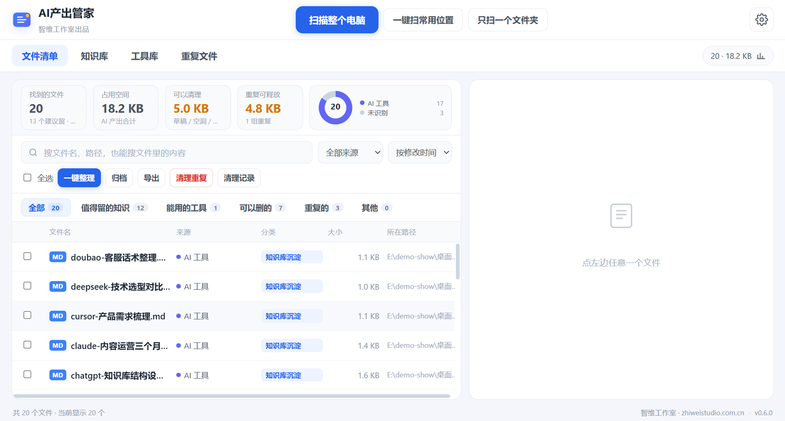
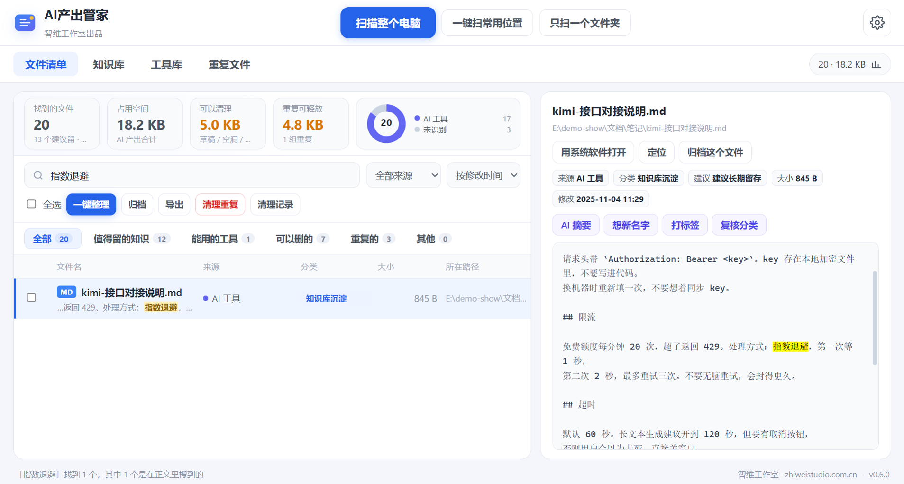
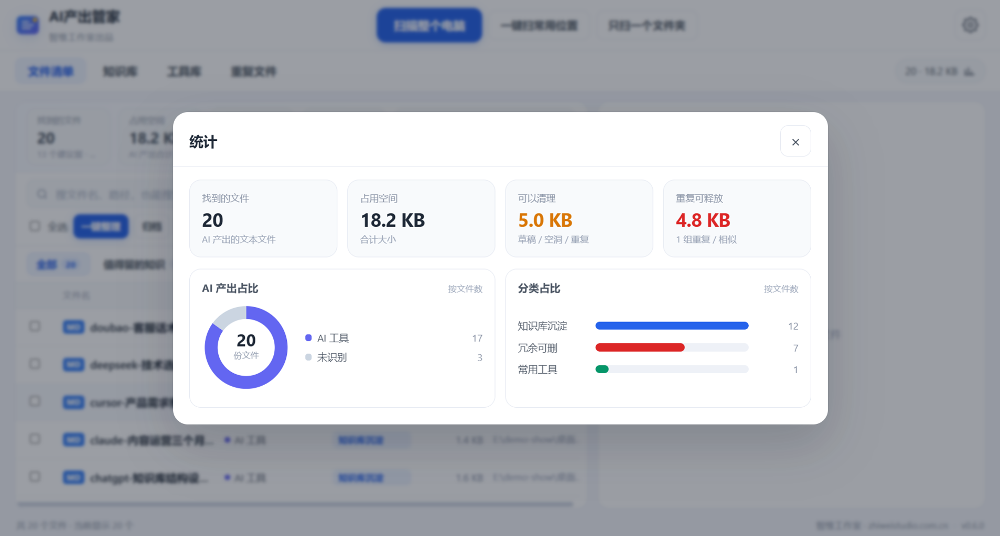

<div align="center">
  
  <h1>AI Artifact Manager</h1>
  <p><b>Manage the files AI tools leave behind</b></p>
  <p>
    
    
    
  </p>
  <p>Free and open source · bring your own AI · nothing leaves your machine</p>
  <p>
    <a href="README.md">中文</a> · <b>English</b>
  </p>
</div>

> Built by **Zhiwei Studio** · [www.zhiweistudio.com.cn](https://www.zhiweistudio.com.cn)
> We build AI apps, desktop tools and automation for clients. If you need something similar, get in touch.

---

## Download

**[⬇ AI Artifact Manager 0.5.0 (Windows 64-bit, 96 MB)](https://github.com/Aiearn-lab/ai-artifact-manager/releases/latest/download/AI-Artifact-Manager-0.5.1-portable.exe)**

Portable — double-click and it runs. No installer, no account, no telemetry.
Settings and data live in an `AI产出管家数据` folder next to the exe; move that folder to move your setup.

---

## What it looks like

**File list** — click any row, the right panel shows the content. No need to open another app.



**Search inside files** — can't remember the filename? Search what you wrote. The matching line is highlighted right in the list.



**Stats** — see which AI produced what, and how much space you could reclaim.



> Screenshots use demo documents, not real user data.

---

## The problem

If you use ChatGPT, Claude, DeepSeek, Cursor or any coding agent for real work, your Downloads folder eventually looks like this:

- `untitled.md`, `未命名 (3).md`, `新建文本文档.txt` everywhere
- The same document as `v1` / `v2` / `final` / `final(2)` — and you can't tell which one is current
- You remember what last week's research said, not what you named the file
- You know half of it is junk, but deleting feels risky

Generic file organizers don't know what an AI artifact is. **This one only does that job:** find AI-generated files, categorize them, tell you what to keep and what to drop.

---

## What it does

### Scan

Whole disk, common locations (Downloads / Desktop / Documents), or a single folder. Skips system folders, program folders and binary file types by default — you can add more.

### Detect the source, without any AI

Pure pattern matching on filenames, header comments and export formats. Recognizes ChatGPT, Claude, DeepSeek, Doubao, Kimi, Cursor, Copilot, Gemini, Qwen and more. No API calls, works offline.

### Categorize and advise

Every file lands in one of three buckets, each with a one-line reason:

- **Knowledge** — long documents worth keeping
- **Scripts** — split into reusable vs one-off
- **Disposable** — auto-named drafts, near-empty files, redundant versions

### See it before you touch it

Click any file to read it inline — md, py, js, json, txt, html. Full-text search reads the first 64 KB of each file, so "I remember writing about pricing" actually finds it, and jumps straight to the matching line.

### Deduplicate

SHA-256 for identical files, 3-gram similarity for near-identical ones. Shows the similarity percentage, which copy to keep, and how much space you'd reclaim. **Only byte-identical files are ever auto-selected for cleanup** — similar ones are flagged, never auto-deleted.

### Tidy up

Move (or copy) the keepers into an archive folder, organized by category. Anything deleted goes to the **Windows Recycle Bin** — the same as right-click → Delete. Restore it from there.

There is no private trash folder. If the system has no Recycle Bin (USB drives, network shares), the app refuses to delete and tells you why.

### Auto watch

Pick a few folders. When new files appear — you download something, an AI writes a file — the app notices within seconds, categorizes them, and shows a banner.

**It only notifies. It never moves or deletes anything on its own.**

### Bring your own AI (optional)

The app ships with zero AI. Everything above works offline without it.

If you want summaries, suggested filenames and tags, connect:

- **Ollama** (port 11434) or **LM Studio** (port 1234) — detected with one click, free, fully local
- **Any OpenAI-compatible API** — your own key, encrypted with the OS keychain (DPAPI), stored locally only

### MCP server

Built-in MCP server (off by default) so Cursor, Claude Desktop or any MCP client can search and organize your artifact library. Supports stdio and local HTTP.

### Windows integration

Optional Explorer right-click entry — right-click any folder to scan it directly.

---

## Why it's free

No Pro tier, no license key, no upsell. The whole thing is MIT.

If it saves you time, a star on this repo is the best way to say thanks. If your team needs something custom — a private deployment, a different classification ruleset, an integration — that's what we do for a living; the link is at the top.

---

## Install & run from source

### Option 1 — download

Grab the portable exe from [Releases](https://github.com/Aiearn-lab/ai-artifact-manager/releases). No Node, no Python needed.

### Option 2 — build it

```bash
git clone https://github.com/Aiearn-lab/ai-artifact-manager.git
cd ai-artifact-manager
npm install
npm start
```

Package:

```bash
npm run dist
```

> Node.js 18+. Output goes to `dist/`.

### First run

1. Scan **Downloads** or **Desktop** — don't start with the whole C: drive
2. Click a few files, check whether the categories make sense
3. Set an archive folder, then hit **Tidy up** when you're comfortable

---

## Privacy

- No account, no telemetry, no analytics, no network calls
- File contents never leave the machine
- If you configure a cloud AI, the text you send goes to *that* provider, not to us — the app warns you before the first call
- API keys are encrypted at rest with the OS keychain
- The whole thing is MIT-licensed; read the source if you want

---

## Stack

Electron · vanilla JS (no framework) · Node.js · no runtime dependencies beyond Electron

---

## License

MIT © Zhiwei Studio
