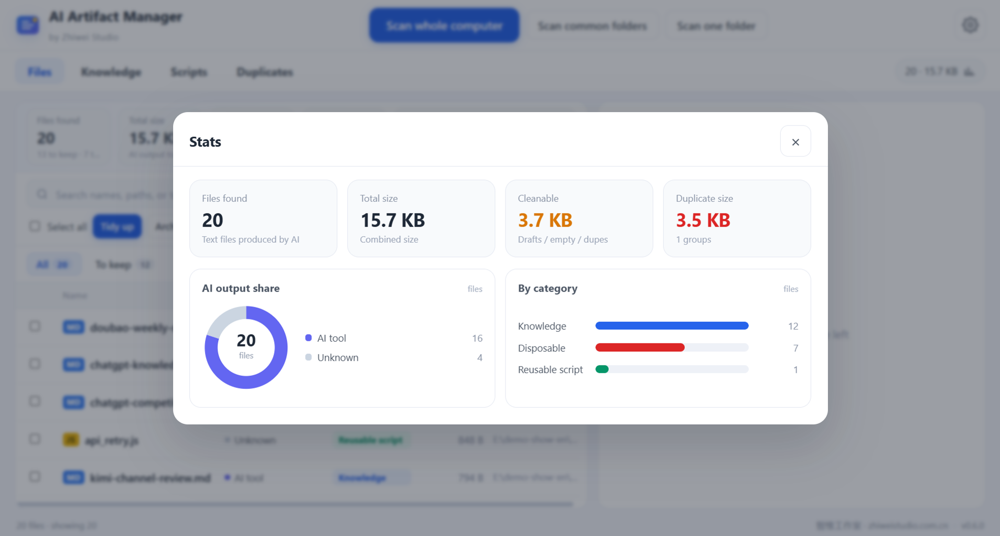

<div align="center">
  
  <h1>AI Artifact Manager</h1>
  <p><b>Find what AI tools left on your disk, sort it, and see what's safe to delete</b></p>
  <p>
    
    
    
    
  </p>
  <p>
    <a href="README.md">中文</a> · <b>English</b>
  </p>
</div>

If you work with ChatGPT, Claude, DeepSeek or Cursor, your disk fills up with `untitled.md`, `proposal_v3_final(2).md` and files you can't even attribute — every AI tool dumps its output somewhere, and generic cleanup tools have no idea what any of it is. This app does that one job: **offline, free, nothing leaves your machine.**

> Heads-up: since v0.8 the in-app interface is Chinese-only (beginner-first redesign). This README stays as the English reference.


## Download

**[⬇ Latest release (Windows 64-bit, ~95 MB)](https://github.com/Aiearn-lab/ai-artifact-manager/releases/latest)** — portable, unzip and double-click. No installer, no account, no Node required.

First launch may show Windows' "protected your PC" screen — that's because we haven't paid for a code-signing certificate yet, not because the file is unsafe: click More info → Run anyway.

Or run from source (bottom of this page).

## Three steps (v0.8 out-of-the-box flow)

1. **It scans on first launch** — the butler walks the whole PC right away; broad scanning is safe because protection comes from hard exclusions and full reversibility, not from narrowing the scan
2. **Click Slim-down** — work is laid out in three tiers by confidence; you only nod where a nod is needed
3. **Stash box & Monthly note** — anything tucked away can be put back anytime; the note page shows what the butler did this month

## What it does

- **Scan** the whole PC on install, or pick a folder. System folders, program folders and known AI-tool cache directories (.accio, Coze, .qoder…) are skipped by default
- **Detect AI output** by filename patterns, header comments and export formats. Exactly two labels: **AI tool / Unknown** — guessing a wrong vendor name costs more trust than not guessing at all
- **Categorize**: Knowledge / Reusable script / One-off script / Disposable, each with a one-line reason
- **One-click Slim-down (three-tier responsibility)**: the tool's confidence decides how hard it acts — byte-identical copies go straight to the Windows Recycle Bin (keepers are never touched); multiple versions of the same file are grouped into cards, and old versions are deleted only after you nod once per group ("keep newest, delete old"); anything still uncertain is **moved to a stash box, never deleted**
- **Stash box**: everything tucked away stays there with no expiry — review it, put files back anytime; emptying it is always your choice, never an auto-action
- **Resident note**: a one-line weekly summary lives in the system tray, and the in-app note page shows four numbers for this month (tucked away / put back / space freed / tidied into archive). All computed from local logs — **zero telemetry**
- **Archive** what you keep into one folder (always a move, never a copy — a tidying tool must not leave you with more files)
- **Deduplicate**: SHA-256 full-file hashing for identical files, 3-gram similarity for near-identical ones; recommends which copy to keep
- **Search inside files** when you remember what you wrote but not what you named it; matches are highlighted inline
- **Auto watch** folders — new AI output is recognized and categorized within seconds (notify only, it never touches files)
- **Bring your own AI (optional)**: one-click Ollama / LM Studio, or any OpenAI-compatible key — unlocks summaries, smart renames, side-by-side compare. Everything works without it



## Safety

- Everything runs locally, works offline, **zero telemetry** — no usage analytics, not even "how many files you cleaned" leaves the machine
- AI tools' own dependencies, memory and caches are **skipped at the scan layer** — they can't be touched even by mistake
- Files of Unknown origin, files you marked "I wrote this", and project code (folders containing package.json/.git) are **never auto-touched by any tier**
- Before deleting a duplicate copy, the keeper's existence is re-checked on the spot — if the keeper is gone, the copy stays too
- Deletions only ever go to the **Windows Recycle Bin**, same as right-click → Delete; closing the window only hides the app to the tray — quit from the tray menu
- Archiving is always a move, never a copy
- API keys stay in local config, never in logs or exports

## For AI assistants: built-in MCP server

Flip one switch and Cursor, Claude Desktop or any MCP client can search and organize your library:

| Tool | What it does |
| --- | --- |
| `search_files` | Search by name, path, tags, category |
| `get_file_summary` | What a file is about |
| `list_by_category` | List files by category |
| `archive_files` | Move files into the archive (originals don't stay) |

```json
{
  "mcpServers": {
    "ai-artifact-manager": {
      "url": "http://127.0.0.1:3927/mcp"
    }
  }
}
```

Listens on `127.0.0.1` only. stdio is also supported — copy the snippet from Settings → MCP.

## Run from source

```bash
git clone https://github.com/Aiearn-lab/ai-artifact-manager.git
cd ai-artifact-manager
npm install
npm start        # Node.js 18+
npm run dist     # build Windows portable
node _test/run_test.js   # unit self-tests (tiers / stash / version chain / note in _test/)
node _test/run_word_gate.js  # plain-language term gate (build-time regex over the UI)
./node_modules/.bin/electron _test/e2e.js  # end-to-end (real window, real delete + restore)
```

> The in-app interface has been Chinese-only since v0.8, so the English UI screenshots above were taken on v0.7 and are kept as historical reference. For the current v0.8 interface, see the Chinese README ([README.md](README.md)), whose screenshots were retaken in this release.

## Free

MIT licensed, every feature free, no Pro tier. If it saves you time, a star is the best thanks.

**Zhiwei Studio** · [www.zhiweistudio.com.cn](https://www.zhiweistudio.com.cn) · 7388603@qq.com
We build AI apps, desktop tools and automation for clients — get in touch if you need something custom.

## License

MIT © 2026 Zhiwei Studio
