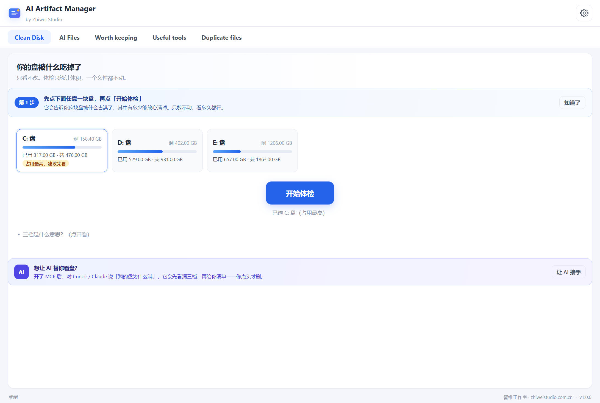
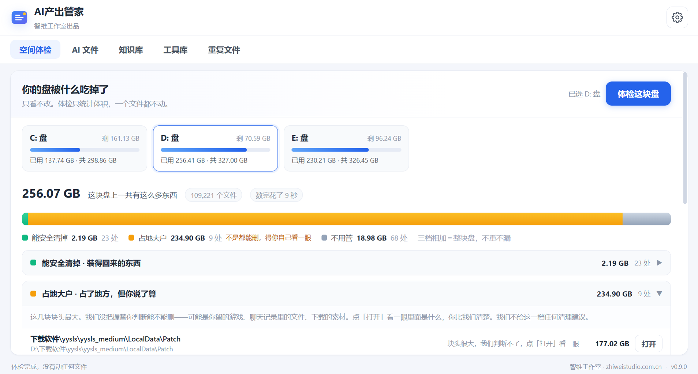

<div align="center">
  
  <h1>AI Artifact Manager</h1>
  <p>
    
    
    
    
  </p>
  <p><a href="README.md">中文</a> · <b>English</b></p>
</div>

Manages the files AI tools pile up on your computer. Offline, free, nothing leaves the machine; deletions go to the Windows Recycle Bin and can be restored.

> Since v0.8 the in-app interface is Chinese-only. This README is the English reference.



## Download

[Latest release (Windows 64-bit)](https://github.com/Aiearn-lab/ai-artifact-manager/releases/latest) — portable, unzip and double-click. No installer or account. If Windows shows "protected your PC" on first launch, click More info → Run anyway.

## Three steps

1. You land on **Disk checkup**. Click "Check this drive"; seconds later you see three tiers — **safe to clear / big blocks / hands off** — whose numbers add up exactly to the drive's real usage. "Open" jumps to the folder
2. **AI files** recognizes and categorizes AI output; **Slim down** handles work by confidence tier
3. The **Stash box** lets you put anything back; the **Monthly note** shows what happened this month



## Features

- **Disk checkup** — measures sizes only, touches nothing, shows the biggest items and where they live, including what the recycle bin is holding
- **One-click cleanup** — clears only the "safe to clear" tier (caches, dependencies, build output); project dependencies are skipped, deletions go to the Recycle Bin, and you see the list before anything happens
- **Peek inside** — walk into a large directory one level at a time to find out what the 177 GB actually is
- **Duplicates** — SHA-256 for identical files, similarity for near-identical ones; every row is tagged "auto-cleaned" or "your call", and copies inside projects are only listed
- **Organize & search** — archiving moves, never copies; full-text search; optional local model or your own API key for summaries and renaming

## Safety

- Runs entirely on this machine, zero telemetry; AI tools' own dependencies, memory and caches are skipped at the scan layer
- Unknown-origin files, files you marked "I wrote this", and project folders (containing package.json / .git) are never auto-touched by any tier
- Deletions only ever go to the Windows Recycle Bin; archiving is always a move, never a copy
- API keys stay in local config, never in logs or exports

## Let AI take over

Once you enable MCP in the app, Cursor, Claude and other AI tools can ask "why is my disk full" or "clear the caches". The AI shows you a list first — nothing is deleted until you say yes. Tool list, permission boundaries and connection config are in [AI-SKILL.md](AI-SKILL.md).

## Run from source

```bash
git clone https://github.com/Aiearn-lab/ai-artifact-manager.git
cd ai-artifact-manager
npm install
npm start        # Node.js 18+
npm run dist     # build Windows portable
node _test/run_test.js        # unit self-tests (more in _test/)
node _test/run_word_gate.js   # plain-language term gate
```

## Contact

**Zhiwei Studio** · [www.zhiweistudio.com.cn](https://www.zhiweistudio.com.cn) · 7388603@qq.com
We build AI apps, desktop tools and automation for clients.

## License

[MIT](LICENSE) © 2026 Zhiwei Studio
