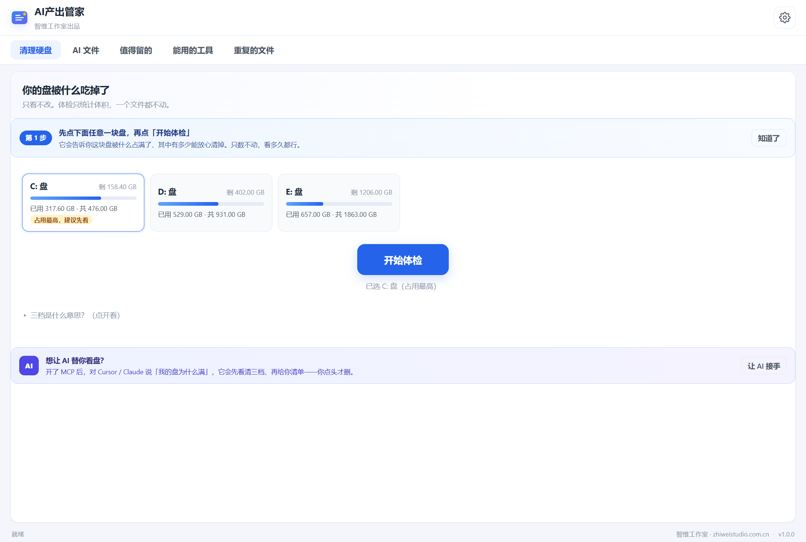
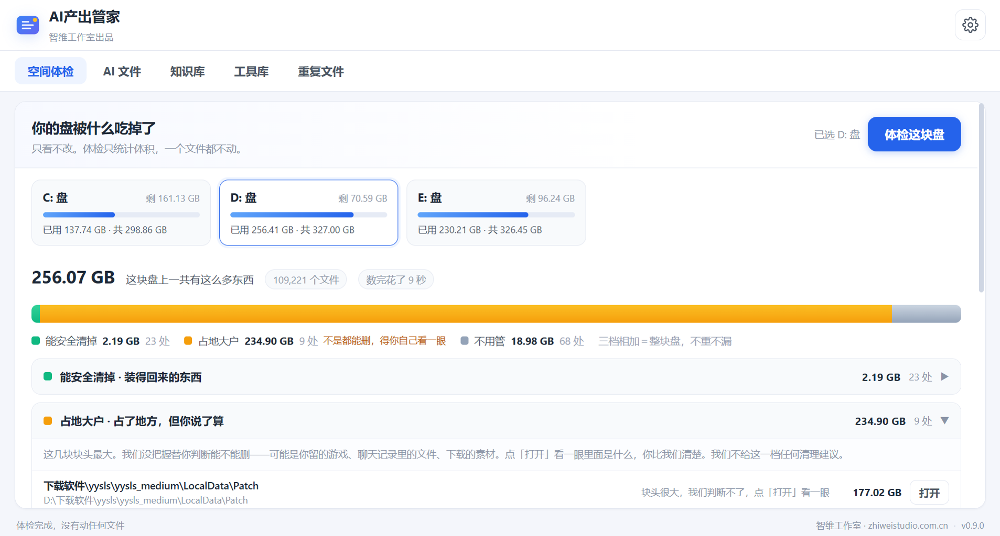
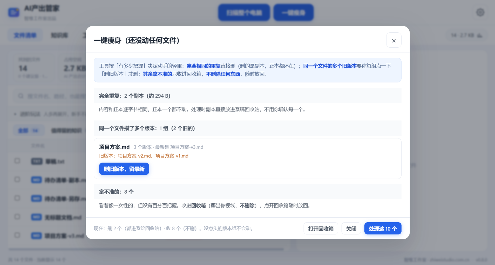
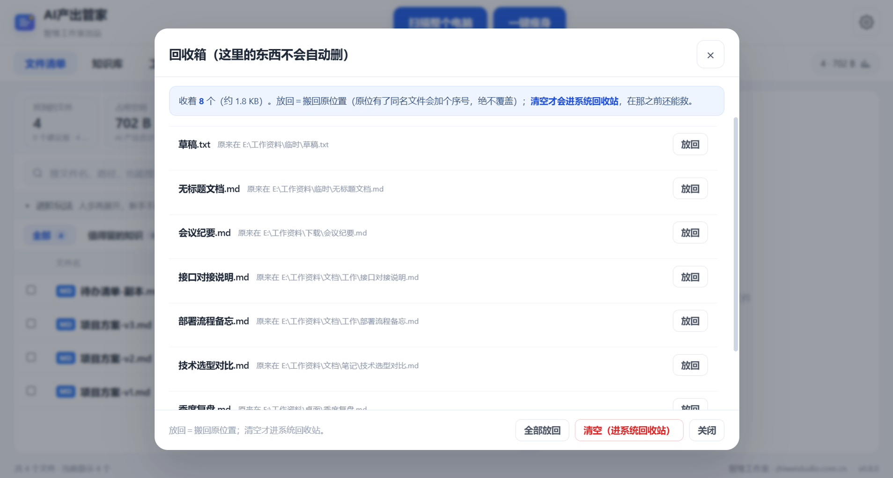
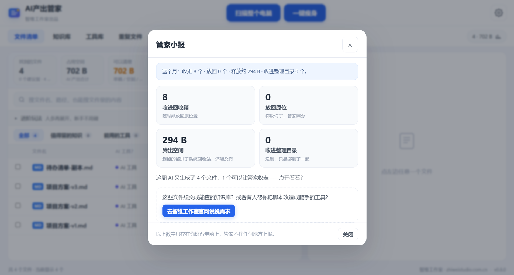

<div align="center">
  
  <h1>AI产出管家 · ai-artifact-manager</h1>
  <p><b>先告诉你硬盘为什么满，再帮你把 AI 堆积的东西认清、分清、收拾干净</b></p>
  <p>
    
    
    
    
  </p>
  <p><b>中文</b> · <a href="README.en.md">English</a></p>
</div>

用 ChatGPT、Claude、DeepSeek、Cursor 干活，几个月后电脑里会堆满 `untitled.md`、`方案_v3_终稿(2).md` 和说不清来路的文件——每个 AI 工具都在往你电脑里塞东西，通用清理工具不认识它们。这个工具专管这件事：**离线、免费、文件不出本机。**





## 下载

**[⬇ 下载最新版（Windows 64 位，约 95 MB）](https://github.com/Aiearn-lab/ai-artifact-manager/releases/latest)** —— 解压双击即用，不用安装、不用注册、不用装 Node。

第一次打开如果 Windows 弹出「已保护你的电脑」：那是因为我们还没花钱买代码签名证书（钱先省着），不是文件有问题。点「更多信息」→「仍要运行」即可。

也可以从源码跑（见文末）。

## 三步上手（v0.9 起：先看清，再动手）

1. **先看「空间体检」**：打开就在第一页。点一下「体检这块盘」，十几秒后你会看到这块盘被分成三档——**能安全清掉 / 占地大户 / 不用管**，三个数字加起来正好等于这块盘的实际占用。哪块最大、在哪个文件夹，一眼就能看出来，点「打开」直接跳到那个目录
2. **再看「AI 文件」**：第一次打开管家会自动把整台电脑盘一遍——扫得宽没关系，安全靠硬排除 + 随时能反悔，不靠缩小范围。想动手就点「一键瘦身」，它把把握大小的活分三档摆给你，只在你要点头的地方等你点头
3. **不放心就去看「回收箱」和「小报」**：收走的文件随时放回；小报告诉你这个月管家帮你动了哪些手

## 它做什么

- **空间体检（v0.9 新增）**：只统计体积、一个文件都不动，回答「我的盘为什么满了」。每块盘分三档——**能安全清掉**（缓存、依赖、构建产物，删了重新装/重新编就回来）、**占地大户**（块头最大的那些，工具不替你判断能不能删，只帮你定位到"哪里最大"并一键打开）、**不用管**（系统、程序、游戏本体、照片、源码）。三档相加**不重不漏**，等于整块盘的实际占用；同时把这块盘回收站里压着的空间也算出来。整个体检支持随时停下
- **扫描**：默认装机就全盘扫一遍；也可以只扫指定文件夹。系统目录、程序目录、常见 AI 工具的缓存目录默认不碰
- **识别**：按文件名、文件头、导出格式判断是不是 AI 产出的。来源只分**「AI 工具 / 未识别」**两类——猜错一个厂商名比不猜更误事
- **分类**：知识库沉淀 / 能用的工具 / 一次性脚本 / 可清理，每个文件一句人话说明为什么
- **一键瘦身（三档责任）**：工具按把握大小决定动手轻重——逐字节相同的副本直接进 Windows 回收站（正本一个都不动）；同一个文件的多个版本分组摆给你，点一次「删旧版本，留最新」旧版本才进回收站；剩下拿不准的**只收进回收箱，不删除**
- **回收箱**：被收起来的文件随时能看、随时放回，无期限；清空永远是你的可选项，不是到期自动执行
- **常驻小报**：系统托盘里一句话周报（这周 AI 又生了多少、哪些可以让管家收走），界面里「小报」页给本月四个数字：收走 / 放回 / 腾出 / 留下。数字只从你这台电脑的本地记录算，**零遥测**
- **整理**：想留的文件也能一键归档到指定目录（只移动，没有复制，越整越少）
- **重复查找**：完全重复（SHA-256 全文哈希）+ 高度相似（3-gram 相似度）都能找出来，推荐保留哪份；删除进 Windows 回收站，可还原。**页面上会逐行标明「会自动清」还是「需你判断」**——内容一样但落在项目文件夹里的（比如同一个 `package.json` 在源码和发布目录各一份），工具只提示、不动手，删不删你定
- **搜内容**：想不起文件名，搜正文里的词，命中那句直接高亮
- **自动监控**：盯住指定文件夹，AI 新写出的文件几秒内认出来、分好类（只提示，不动手）
- **接自己的 AI（可选）**：一键连 Ollama / LM Studio，或填自己的 API 密钥，解锁摘要、智能重命名、两版比对。不接也全能用







## 安全机制

- 全部在本机完成，离线可用，**零遥测**：不统计使用行为，连「你清了多少文件」这种数字都不上传（关于页写死了这句话）
- AI 工具自身的依赖、记忆、缓存目录**在扫描层就直接跳过**，想碰都碰不到
- 来源未识别的文件、「这是我写的」、项目内代码（含 package.json/.git 的目录）**任何档位都不会自动碰**
- 删重复副本前会当场复核「正本还在原位」——正本不在了就连副本也不动
- 删除只进 Windows 回收站（和右键删除一样），从不永久删除；关掉窗口只是收进托盘，退出要点托盘里的「退出管家」
- 归档一律移动，没有复制——整理工具不该越整越多
- 密钥只存本机配置文件，不写进日志和导出

## 给 AI 助手用：内置 MCP 服务

软件里一键开启后，Cursor、Claude 等 MCP 客户端可以直接检索和整理你的文件库：

| 工具 | 作用 |
| --- | --- |
| `search_files` | 按文件名、路径、标签、分类搜索 |
| `get_file_summary` | 看某个文件讲什么 |
| `list_by_category` | 按分类列文件 |
| `archive_files` | 移动归档（原位置不再保留） |

```json
{
  "mcpServers": {
    "ai-artifact-manager": {
      "url": "http://127.0.0.1:3927/mcp"
    }
  }
}
```

只监听 `127.0.0.1`。也支持 stdio，配置片段在「设置 → MCP 服务」里一键复制。

## 从源码运行

```bash
git clone https://github.com/Aiearn-lab/ai-artifact-manager.git
cd ai-artifact-manager
npm install
npm start        # 需要 Node.js 18+
npm run dist     # 打包 Windows portable
node _test/run_test.js   # 单元自测（三档/回收箱/版本链/小报等专项同在 _test/ 下）
node _test/run_word_gate.js  # 小白首屏术语闸（构建期正则，出黑话即红）
./node_modules/.bin/electron _test/e2e.js  # 端到端（真开窗口真删真放回，须用 Electron 跑）
```

> 中文界面截图已全部重拍为 v0.8（主界面、一键瘦身、回收箱、管家小报）。`docs/screenshots/en/` 下的英文界面截图摄于 v0.7，保留作历史参考——v0.8 起应用界面只有中文。

## 免费 + 联系

MIT 协议，全部功能免费，没有 Pro。觉得有用就点个 star。

**智维工作室 / Zhiwei Studio** · [www.zhiweistudio.com.cn](https://www.zhiweistudio.com.cn) · 7388603@qq.com
承接 AI 应用、桌面工具、自动化脚本的定制开发。

## License

[MIT](LICENSE) © 2026 智维工作室 Zhiwei Studio
